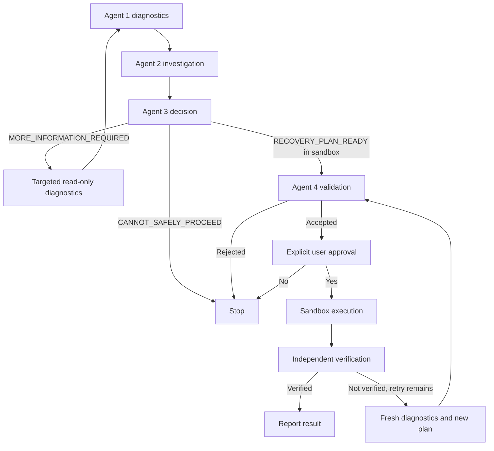

# Architecture

## System components

PenguinMedic is a Python application coordinated by a LangGraph state graph. It has three LLM-based agents, registered Python diagnostic tools, a privacy filter and a deterministic safety layer.

| Component | Location | Responsibility |
|---|---|---|
| CLI | `main.py` | Presents Sandbox Demonstrations and Live Read-Only Diagnostics |
| Agent 1 | `agents/diagnostic.py`, diagnostic nodes in `graph/nodes.py` | Selects registered checks and produces a structured evidence report |
| Agent 2 | `agents/investigation.py` | Evaluates supporting and contradicting evidence, possible causes and uncertainty |
| Agent 3 | `agents/solution.py` | Chooses whether more information is needed, the system should stop, or a sandbox plan is justified |
| Agent 4 | `tools/command_validator.py`, `graph/approval.py`, `tools/command_executor.py`, `tools/recovery_verification.py` | Deterministic validation, explicit approval, sandbox execution and independent verification |
| Diagnostics | `tools/diagnostics.py`, `tools/package_diagnostics.py`, `tools/system_diagnostics.py` | Collects real system evidence using registered read-only tools |
| Privacy filter | `tools/privacy_filter.py` | Sanitises selected diagnostic evidence before cloud analysis |
| Workflow | `graph/workflow.py`, `graph/state.py`, `graph/nodes.py` | Maintains shared state and routes between workflow stages |
| Skills | `skills/` | Provides task-specific instructions to the LLM agents |
| Sandbox fixtures | `sandbox/fixtures/` | Holds fixed files used by the sandbox demonstrations |

## Models

- Agent 1 uses Qwen through the local LM Studio OpenAI-compatible endpoint at `http://localhost:1234/v1`.
- Agents 2 and 3 use `openai/gpt-oss-20b` through the Groq API.
- Agent 4 is deterministic Python code, not a language model.

## Workflow

1. The user selects one of the two CLI modes and describes the issue or selects a sandbox scenario.
2. Agent 1 chooses from the application's registered diagnostic tools.
3. Python tools collect diagnostic results. In live mode, these are read-only observations from the actual system. In sandbox mode, the workflow uses controlled scenario evidence and fixtures.
4. Agent 1 organises the results into a structured diagnostic report.
5. The privacy filter sanitises selected report fields before cloud investigation.
6. Agent 2 evaluates evidence, plausible causes, contradictions and uncertainty.
7. Agent 3 returns one of three decisions:
   - `MORE_INFORMATION_REQUIRED`: request targeted read-only diagnostics.
   - `CANNOT_SAFELY_PROCEED`: stop without recovery.
   - `RECOVERY_PLAN_READY`: in the current application, this can enter the recovery gate only in Sandbox Demonstrations.
8. For an eligible sandbox plan, Agent 4 validates the exact registered operation.
9. The CLI requests explicit user approval.
10. The executor performs the approved sandbox operation and an independent verifier checks the expected result.

## Safety boundary

The language models do not execute shell commands directly. Recovery plans are treated as untrusted data and must pass deterministic validation. The executor accepts only registered sandbox operations. Approval is tied to the approved operation and attempt; a retry requires fresh evidence, a new plan and new approval.

Live Read-Only Diagnostics never enters the recovery execution path. It can display an assessment or recommendation, but it does not validate a plan for execution, request approval or modify the host system.

## Decision routing

## Data and privacy

The local diagnostic model is used for the initial diagnostic stage. Selected diagnostic evidence is passed through the privacy filter before the cloud investigation and solution stages. The filter is a best-effort mitigation and should not be treated as a guarantee that secrets or personal data can never pass through.
