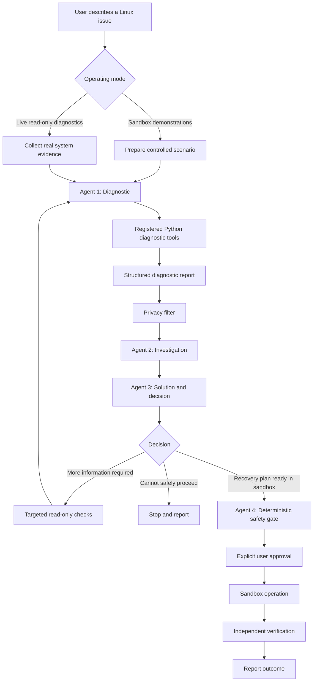

# PenguinMedic

**An agentic Linux troubleshooting assistant built with Python, LangGraph, local and cloud LLMs.**

PenguinMedic investigates Linux problems using read-only diagnostic tools, then explains its findings through a coordinated multi-agent workflow. It also includes controlled sandbox demonstrations of recovery planning, explicit approval and verification.

## Operating modes

The current application exposes exactly two operating modes:

### 1. Sandbox Demonstrations

A controlled environment for demonstrating four troubleshooting scenarios:

- **Missing file:** Detects a missing sandbox file and restores it from a known-good fixture after approval.
- **Broken configuration:** Detects malformed sandbox JSON and restores a valid fixture after approval.
- **Recovery retry:** Simulates a failed first attempt, gathers fresh evidence, creates a new plan and requires approval again before retrying.
- **Cannot safely proceed:** Uses conflicting synthetic evidence to demonstrate that PenguinMedic can stop without executing a recovery operation.

All sandbox changes are restricted to the project's `sandbox/fixtures/` directory. These demonstrations do not repair the host operating system or use the package manager to restore real system files.

### 2. Live Read-Only Diagnostics

Inspects the actual Linux system using registered diagnostic tools. Depending on the problem, PenguinMedic can collect information about:

- Operating system and hardware
- CPU, memory and disk usage
- Failed systemd services
- System journal entries
- Pacman package database and transaction logs
- Pacman configuration and local mirrorlist entries

The agents analyse the collected evidence and return observations, possible causes, uncertainty and recommendations. **This mode is read-only:** it does not install packages, edit configuration, restart services or execute recovery operations.

## How it works



### The four agents

| Component | Technology | Responsibility |
|---|---|---|
| Agent 1: Diagnostic | Local Qwen through LM Studio | Selects registered diagnostic tools and builds an evidence-based report |
| Agent 2: Investigation | Groq `openai/gpt-oss-20b` | Evaluates evidence, possible causes and uncertainty |
| Agent 3: Solution | Groq `openai/gpt-oss-20b` | Decides whether more evidence is needed, it is safer to stop, or a sandbox recovery plan is justified |
| Agent 4: Safety and execution | Deterministic Python | Validates sandbox operations, obtains explicit approval, executes and verifies |

Agent 4 is not an LLM. It is a deterministic safety layer.

## Technology stack

- **Python** for application logic and diagnostic tools
- **LangGraph** for workflow orchestration, shared state and conditional routing
- **LM Studio + Qwen** for local diagnostic reasoning
- **Groq + GPT-OSS** for investigation and solution planning
- **Pydantic** for structured model outputs
- **python-dotenv** for local environment configuration

See [Architecture](docs/ARCHITECTURE.md) for the component breakdown and workflow details.

## Requirements

- Linux
- Python 3.10 or newer recommended
- LM Studio with `qwen/qwen3.5-9b` available
- LM Studio's OpenAI-compatible server running at `http://localhost:1234/v1`
- A Groq API key
- `systemd`/`journalctl` and Pacman utilities for the corresponding diagnostics (Pacman checks are Arch Linux-specific)

## Installation

### 1. Clone the repository

```bash
git clone https://github.com/<YOUR_USERNAME>/PenguinMedic.git
cd PenguinMedic
```

### 2. Create a virtual environment

**Bash/Zsh**
```bash
python -m venv .venv
source .venv/bin/activate
```

**Fish**
```fish
python -m venv .venv
source .venv/bin/activate.fish
```

### 3. Install dependencies

```bash
pip install -r requirements.txt
```

### 4. Configure the Groq API key

```bash
cp .env.example .env
```

Add your key to `.env`:

```dotenv
GROQ_API_KEY=your_groq_api_key_here
```


### 5. Start the local model

Open LM Studio, load `qwen/qwen3.5-9b`, and start its local OpenAI-compatible server at `http://localhost:1234/v1`.

### 6. Run PenguinMedic

```bash
python main.py
```

## Project structure

```text
PenguinMedic/
├── agents/                 # Diagnostic, investigation and solution agents
├── docs/
│   └── ARCHITECTURE.md     # Architecture and workflow details
├── graph/                  # LangGraph state, nodes and workflow
├── sandbox/
│   └── fixtures/           # Isolated files used by sandbox demonstrations
├── shared/                 # Shared structured schemas
├── skills/                 # Agent instruction files
├── tools/                  # Diagnostics, privacy, validation and sandbox execution
├── .env.example
├── .gitignore
├── main.py                 # CLI entry point
└── requirements.txt
```

## Safety and limitations

- Live diagnostics are read-only.
- Sandbox recovery operations are restricted to fixed project fixtures.
- Every sandbox recovery operation must pass deterministic validation and receive explicit user approval.
- Verification checks the resulting fixture state rather than relying only on command success.
- The retry demonstration is bounded and requires fresh evidence and new approval.
- The privacy filter reduces exposure of sensitive-looking information but cannot guarantee perfect sanitisation.
- The missing-file demonstration restores a fixture. It does not locate, download, extract or reinstall an Arch package.
- Diagnostic coverage depends on the available system utilities and permissions.

PenguinMedic is an academic prototype. Its diagnostic output is decision support, not a guarantee that a suspected cause is correct.
